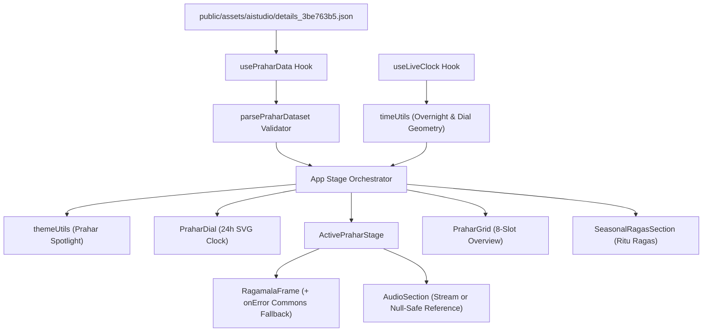

# Astha prahar


**Astha prahar** is an interactive 24-hour Hindustani classical raga clock and Ragamala miniature gallery. Inspired by the intimate lighting of a classical *baithak* recital, the stage shifts its warm radial illumination dynamically across dawn, morning, midday, afternoon, dusk, early night, midnight, and pre-dawn prahars while pairing each three-hour window with its corresponding raga profile, museum Ragamala folio, and transparent archival audio reference.

## Features

- **Live 24-Hour Prahar Dial**: Circular SVG clock segmented into all eight three-hour prahars (`04:00–07:00` through `01:00–04:00`), including clean overnight wrap-around (`22:00–01:00`), live local clock hand, keyboard-accessible segment selection, `Previous` / `Next` controls, and `Jump to Now`.
- **Dynamic Baithak Stage Atmosphere**: Subtle radial spotlight shifting from rose-gold dawn and warm brass midday to deep amber dusk and cool indigo-gold midnight.
- **Ragamala Miniature Framing**: Framed folio cards with double hairline gold borders, school/origin provenance, museum credit and license lines, and resilient `onError` fallbacks linking directly to Wikimedia Commons.
- **Transparent Archival Audio**: Renders native `<audio controls>` whenever `direct_audio_url` is present, and an explicit `"Direct stream not attached yet"` state with archival notes and verified external source links whenever `direct_audio_url` is `null`.
- **All 8 Prahars & Seasonal Ragas**: Compact 8-card overview grid plus a dedicated *Ritu Ragas* section for Monsoon (`Megh Malhar`) and Spring (`Basant`).

## Architecture



## Local Setup

1. Install dependencies:
   ```bash
   npm install
   ```
2. Start the development server on port 3000:
   ```bash
   npm run dev
   ```
3. Run typechecking and automated tests:
   ```bash
   npm run lint
   npm test
   ```
4. Build for production:
   ```bash
   npm run build
   ```
